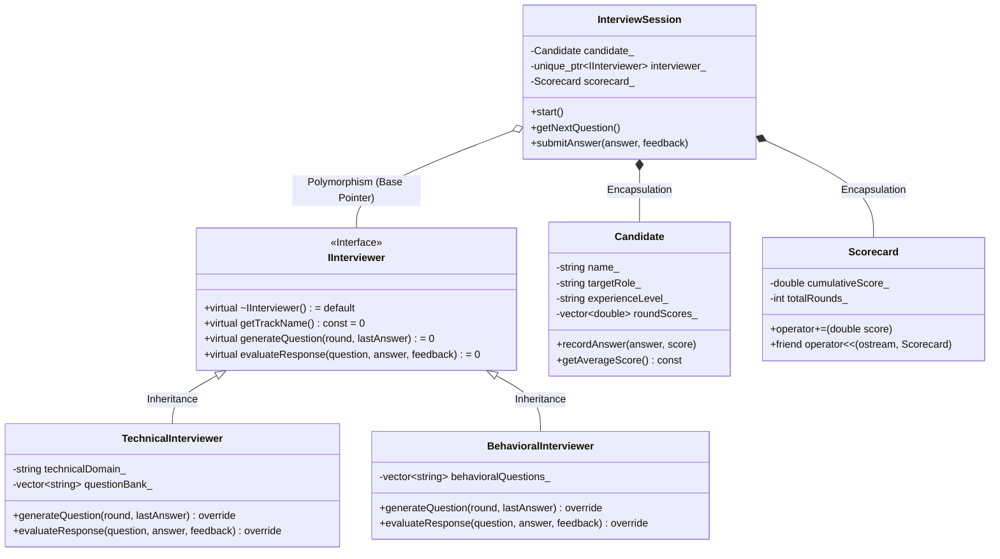

# IntervueAI: AI Mock Interview Platform (C++17 OOP Architecture)

[](https://en.cppreference.com/w/cpp/17)
[-black.svg?logo=next.js)](https://nextjs.org)
[](https://tailwindcss.com)
[](https://vercel.com)
[](LICENSE)

**IntervueAI** is a clean, production-grade conversational AI Mock Interview Bot built as a semester engineering project for an **Object-Oriented Programming in C++ (OOPS)** course.

It delivers a minimal, distraction-free **ChatGPT / Claude-style conversational interface** where candidates can practice realistic technical and behavioral interviews for **any role or topic**:
- `Software Engineer (DSA)`
- `Full-Stack Web Developer`
- `Data Science & AI`
- `Python / Java / C++`
- `System Design`
- `HR & Behavioral (STAR Method)`
- *Any custom engineering role typed by the user*

---

## 🏛️ Authentic C++17 OOP Architecture (`/cpp_engine`)

The underlying architecture of the interview bot is designed in standard C++17 demonstrating the core pillars of Object-Oriented Programming:



### 1. Abstraction (Pure Virtual Contracts)
- `IInterviewer`: Pure virtual interface establishing the contract for all interview tracks (`generateQuestion() = 0`, `evaluateResponse() = 0`).

### 2. Encapsulation (Data Hiding & Validation)
- `Candidate`: Encapsulates sensitive candidate telemetry and evaluation scores behind strict `private:` access specifiers with boundary validation (scores bounded between 0.0 and 10.0).
- `InterviewSession`: Finite state machine safeguarding round progression and throwing custom `InterviewSessionException` on invalid state transitions.

### 3. Inheritance & Runtime Polymorphism
- `TechnicalInterviewer` and `BehavioralInterviewer` inherit from `IInterviewer`.
- A base interface pointer (`std::unique_ptr<IInterviewer>`) dynamically dispatches question generation and rubric grading at runtime via the virtual method table (VTable).

### 4. Compile-Time Polymorphism & Templates
- **Operator Overloading:** `operator+=` for incremental score accumulation, and `friend std::ostream& operator<<` for streaming formatted interview report cards.
- **Templates:** `QuestionRepository<T>` template container for generic rubric item management.

---

## 💻 Standalone C++17 Terminal Engine

The standalone C++ terminal version is in `/cpp_engine` and compiles with any C++17 compiler (GCC / Clang / MSVC):

```bash
# Compile with g++
g++ -std=c++17 cpp_engine/main.cpp -o cpp_engine/interview_bot.exe

# Run terminal interview bot
./cpp_engine/interview_bot.exe
```

---

## 🌐 Next.js Web Application (ChatGPT / Claude Style)

- **Clean Matte Dark Theme:** Strict `#09090b` (`zinc-950`) and `#18181b` (`zinc-900`) flat surfaces with crisp 1px borders — zero neon gradients or glow clutter.
- **Collapsible Sidebar (260px):** Fast switching between roles, experience levels (`Fresher`, `Junior`, `Mid-Level`, `Senior`), and session length (`5 Qs`, `10 Qs`, or `Endless`).
- **Conversational Chat Thread:** Turn-by-turn dialogue between the AI Interviewer and Candidate.
- **Fair Scoring Engine:** High-quality answers receive full marks up to 10/10 with constructive feedback.
- **Always Clean Inputs:** Answer input box is always completely empty (`""`) for the user to type their response from scratch.
- **Scorecard Modal & Report Export:** Full summary card and 1-click Markdown (`.md`) export.

---

## 🚀 Running Locally

```bash
# 1. Install dependencies
npm install

# 2. Start local development server
npm run dev
```

Open [http://localhost:3000](http://localhost:3000) in your browser.

---

## 🌐 Instant Vercel Deployment

1. Push this repository to GitHub.
2. Import the repository into [Vercel](https://vercel.com/new).
3. *(Optional)* Add your free LLM API key in **Environment Variables**:
   - `GROQ_API_KEY`: `gsk_...` (Free at [console.groq.com](https://console.groq.com/keys))
   - `GEMINI_API_KEY`: `AIza...` (Free at [aistudio.google.com](https://aistudio.google.com/))
4. Click **Deploy**. If no API key is set, the built-in offline evaluation engine operates seamlessly.

---

## 📂 Repository Structure

```
ai-interview-bot/
├── cpp_engine/
│   ├── InterviewEngine.hpp   # C++17 OOP Class hierarchy & pure virtual interfaces
│   ├── main.cpp              # Terminal interactive interview bot entrypoint
│   └── interview_bot.exe     # Standalone compiled binary
├── src/
│   └── app/
│       ├── layout.tsx        # IntervueAI root layout (Zinc dark theme)
│       ├── globals.css       # Matte dark design system tokens
│       ├── page.tsx          # Single-screen ChatGPT-style conversational interface
│       └── api/
│           ├── interview/    # AI evaluation & multi-role question dispatch
│           └── source/       # C++ engine source file delivery
├── public/                   # Static assets & icons
├── vercel.json               # Vercel deployment configuration
├── tailwind.config.ts        # Tailwind CSS configuration
├── tsconfig.json             # TypeScript configuration
└── package.json              # Project dependencies & build scripts
```

---

## 📜 License
Distributed under the MIT License. Built for Computer Science Object-Oriented Programming (OOPS) coursework.
